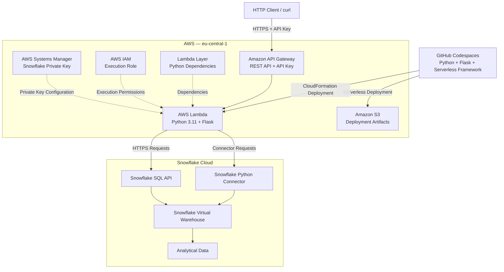

# Snowflake Python API on AWS Lambda

A serverless REST API built with **Python, Flask, AWS Lambda, API Gateway, and Snowflake**. This project demonstrates how to expose Snowflake analytical queries through authenticated HTTP endpoints using two different connectivity approaches: the Snowflake Python Connector and the Snowflake SQL API.

The application was deployed to AWS, tested against a Snowflake database, and successfully validated across all six endpoints.

## 1. Project Overview

The purpose of this project is to demonstrate how a serverless application can retrieve analytical data from Snowflake and expose it through REST endpoints without maintaining a continuously running application server.

The implementation combines:

- **Flask:** Defines HTTP routes and formats API responses.
- **AWS API Gateway:** Exposes HTTPS endpoints and enforces API key requirements.
- **AWS Lambda:** Executes the Python application on demand.
- **Lambda Layer:** Provides the application's Python dependencies.
- **Snowflake:** Stores and processes the analytical data.
- **AWS Systems Manager Parameter Store:** Stores the Snowflake private key used during deployment.
- **AWS IAM:** Controls deployment and runtime permissions.
- **Amazon S3:** Stores Serverless deployment artifacts.
- **Serverless Framework:** Packages and deploys the AWS infrastructure.
- **Docker:** Provides a Lambda-compatible environment for packaging Python dependencies.
- **GitHub Codespaces:** Provides the development environment.

## 2. Architecture



### Request lifecycle

1. A client sends an HTTPS GET request with an API key.
2. API Gateway validates the API key requirement.
3. API Gateway invokes the Lambda function.
4. Lambda initializes the Flask application and resolves the requested route.
5. The application queries Snowflake using either the Python Connector or SQL API.
6. Snowflake executes the query using its virtual warehouse.
7. The result is returned to Lambda.
8. Flask serializes the result into JSON.
9. API Gateway returns the HTTP response to the client.

## 3. Project Structure

```text
snowflake-python-api-aws-lambda/
├── README.md
└── tutorial-source/
    ├── app.py
    ├── connector.py
    ├── sqlapi.py
    ├── api_auth.py
    ├── config.py
    ├── utils.py
    ├── requirements.txt
    ├── serverless.yml
    ├── serverless-template.yml
    ├── package.json
    ├── package-lock.json
    ├── .gitignore
    ├── LICENSE
    └── README.md
```

The original tutorial source is retained in `tutorial-source/`. The root README documents the completed implementation and deployment experience.

## 4. Implementation Timeline

### Phase 1 — Development environment

The project was developed in GitHub Codespaces.

The development environment included Python 3.11, Node.js, Docker, the AWS CLI, and Serverless Framework v3.

The original Snowflake Labs source code was used as the starting point for the implementation.

### Phase 2 — Flask application

The application exposes six GET endpoints.

The implementation separates the two Snowflake access methods into different Python modules:

- `connector.py`: Queries Snowflake using the Python Connector.
- `sqlapi.py`: Queries Snowflake through the SQL API.

The Flask application is exposed to AWS Lambda through the WSGI handler provided by `serverless-wsgi`.

### Phase 3 — Snowflake authentication

The application uses Snowflake key-pair authentication.

A private key was stored in AWS Systems Manager Parameter Store as a SecureString parameter.

The Serverless configuration references this parameter instead of storing the private key directly in the source code.

Snowflake connection settings include the account identifier, user, database, schema, and warehouse.

### Phase 4 — AWS infrastructure preparation

AWS resources and permissions were prepared for deployment.

**IAM execution role**

An IAM role was configured for the Lambda function.

The deployment process also required permissions for managing the resources created through Serverless Framework and CloudFormation.

**S3 deployment bucket**

An S3 bucket was configured to store the deployment artifacts produced by Serverless Framework.

**API Gateway**

The API was configured as a REST API with six GET routes.

Each route requires an API key.

**AWS Lambda**

A Python 3.11 Lambda function was configured to execute the Flask application.

The function uses the `wsgi_handler.handler` entry point and has a 15-second timeout.

**Lambda Layer**

Python dependencies were packaged separately into a Lambda Layer.

This keeps the dependency installation process separate from the application source package.

### Phase 5 — Dependency packaging and compatibility

One of the main technical challenges was a native dependency compatibility issue.

The initial Lambda deployment returned HTTP 502 errors.

CloudWatch logs identified the underlying problem:

```text
ImportError: /lib64/libc.so.6:
version `GLIBC_2.28' not found
```

The error originated from the native Rust extension used by the `cryptography` Python package.

The Lambda Python 3.11 runtime was using an environment with GLIBC 2.26, while the packaged dependency required GLIBC 2.28.

**Investigation**

The dependency archive was inspected to identify the wheel selected during packaging.

The incompatible package contained:

```text
cryptography 41.0.5
manylinux_2_28_x86_64
```

The same dependency was then downloaded and tested using a Lambda-compatible Docker image.

The Docker environment successfully selected a compatible wheel:

```text
cryptography 41.0.5
manylinux_2_17_x86_64
manylinux2014_x86_64
```

**Resolution**

The Serverless Python requirements configuration was updated to use Docker-based packaging, enforce a compatible wheel platform, and disable dependency caches.

```yaml
pythonRequirements:
  dockerizePip: true
  dockerImage: public.ecr.aws/sam/build-python3.11:latest
  layer: true
  useStaticCache: false
  useDownloadCache: false
  pipCmdExtraArgs:
    - "--only-binary=:all:"
    - "--platform=manylinux2014_x86_64"
```

After rebuilding the package, the wheel metadata confirmed the correct platform tags:

```text
Tag: cp37-abi3-manylinux_2_17_x86_64
Tag: cp37-abi3-manylinux2014_x86_64
```

The application was redeployed successfully, and the previously failing endpoint returned HTTP 200.

**Key learning:** Native Python dependencies must be packaged for the target Lambda runtime, not merely for the development machine. Dependency caching can also preserve incompatible artifacts between builds.

### Phase 6 — Serverless deployment

The application was deployed using Serverless Framework.

```bash
cd tutorial-source

AWS_PROFILE=<AWS_PROFILE> \
AWS_REGION=eu-central-1 \
npx serverless package --config serverless.yml
```

After verifying the dependency archive:

```bash
AWS_PROFILE=<AWS_PROFILE> \
AWS_REGION=eu-central-1 \
npx serverless deploy --config serverless.yml
```

Serverless Framework provisioned the application resources through AWS CloudFormation.

The deployed infrastructure included the Lambda function, dependency layer, API Gateway configuration, and API key configuration.

### Phase 7 — Endpoint validation

All six endpoints were tested through API Gateway.

| Method | Endpoint | Connectivity | Result |
|---|---|---|---|
| GET | `/trips/monthly` | Python Connector | HTTP 200 |
| GET | `/trips/day_of_week` | Python Connector | HTTP 200 |
| GET | `/trips/temperature` | Python Connector | HTTP 200 |
| GET | `/sqlapi/trips/monthly` | Snowflake SQL API | HTTP 200 |
| GET | `/sqlapi/trips/day_of_week` | Snowflake SQL API | HTTP 200 |
| GET | `/sqlapi/trips/temperature` | Snowflake SQL API | HTTP 200 |

Example request:

```bash
curl \
  -H "x-api-key: <API_KEY>" \
  "https://<API_ID>.execute-api.eu-central-1.amazonaws.com/dev/trips/monthly"
```

Example response:

```json
{
  "result": [
    [3, "Jun"],
    [2, "Jul"],
    [1, "Aug"]
  ],
  "time_ms": 284
}
```

The SQL API endpoints returned equivalent analytical results, with numeric values represented as strings in the observed JSON responses.

## 5. Test Results

The following results were recorded during the successful integration test on October 1, 2026.

| Endpoint | HTTP Status | Reported Time |
|---|---|---:|
| `/trips/monthly` | 200 | 284 ms |
| `/trips/day_of_week` | 200 | 407 ms |
| `/trips/temperature` | 200 | 924 ms |
| `/sqlapi/trips/monthly` | 200 | 1279 ms |
| `/sqlapi/trips/day_of_week` | 200 | 265 ms |
| `/sqlapi/trips/temperature` | 200 | 688 ms |

**Result: 6/6 endpoint tests passed.**

These values represent individual observed responses rather than benchmark averages.

## 6. Security Considerations

The implementation uses several security mechanisms:

- API key requirements on all exposed API Gateway routes.
- Snowflake key-pair authentication.
- Private key storage in AWS Systems Manager Parameter Store.
- IAM permissions for deployment and Lambda execution.
- HTTPS communication between the client, AWS services, and Snowflake.

**Important:** An API key is not a substitute for full user authentication or authorization.

For a production implementation, additional controls should be considered, including least-privilege IAM policies, restricted Snowflake roles, secret rotation, monitoring, and appropriate API authentication.

The demonstrated deployment resolves the SSM parameter during deployment. A production-oriented improvement would be to retrieve sensitive values securely at runtime rather than embedding resolved secrets into Lambda configuration.

## 7. Technologies

| Category | Technology |
|---|---|
| Programming language | Python 3.11 |
| Web framework | Flask |
| API infrastructure | Amazon API Gateway |
| Serverless compute | AWS Lambda |
| Infrastructure deployment | Serverless Framework v3 |
| Data platform | Snowflake |
| Database connectivity | Snowflake Python Connector |
| Alternative connectivity | Snowflake SQL API |
| Authentication | Snowflake key-pair authentication |
| Secret storage | AWS Systems Manager Parameter Store |
| Permissions | AWS IAM |
| Deployment artifacts | Amazon S3 |
| Dependency packaging | Docker |
| Development environment | GitHub Codespaces |

## 8. Key Takeaways

This project provided practical experience with:

1. Deploying a Flask REST API on AWS Lambda.
2. Configuring API Gateway endpoints and API key requirements.
3. Connecting a serverless application to Snowflake.
4. Comparing Python Connector and SQL API connectivity.
5. Configuring IAM roles, SSM parameters, and deployment artifacts.
6. Packaging Python dependencies into Lambda Layers.
7. Debugging native dependency compatibility errors using CloudWatch logs.
8. Resolving GLIBC compatibility issues through Docker-based packaging.
9. Validating a deployed API through end-to-end HTTP tests.

## 9. Resource Cleanup

The deployed AWS resources can be removed after testing to avoid unnecessary charges.

From the `tutorial-source/` directory:

```bash
AWS_PROFILE=<AWS_PROFILE> \
AWS_REGION=eu-central-1 \
npx serverless remove --config serverless.yml
```

Separately created resources, including the deployment bucket, IAM role, SSM parameter, and retained CloudWatch log groups, may require additional cleanup.

The cleanup command should only be executed when the deployed API is no longer needed.

## 10. References

- [Snowflake Labs — Original Tutorial Repository](https://github.com/Snowflake-Labs/sfguide-snowflake-python-api)
- [AWS Lambda Documentation](https://docs.aws.amazon.com/lambda/)
- [Amazon API Gateway Documentation](https://docs.aws.amazon.com/apigateway/)
- [Snowflake Python Connector Documentation](https://docs.snowflake.com/en/developer-guide/python-connector/python-connector)
- [Snowflake SQL API Documentation](https://docs.snowflake.com/en/developer-guide/sql-api/index)
- [Serverless Framework Documentation](https://www.serverless.com/framework/docs)

---

**Project status:** Successfully deployed and functionally validated on October 1, 2026. All six API endpoints returned HTTP 200 during testing.